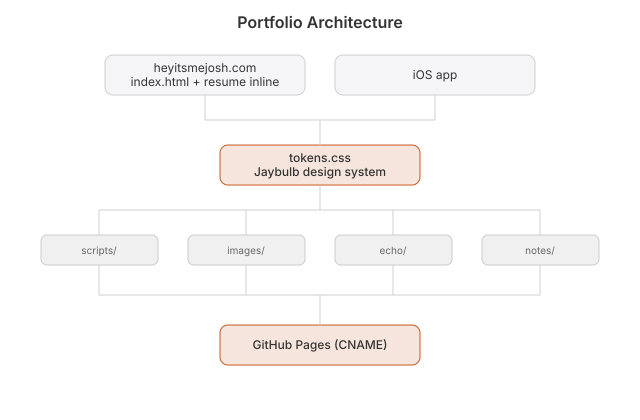

# Architecture

WebKit browser for Mac, iPhone and iPad from one xcodegen target. WebKit does the browsing; Blackcomb adds a start page, a reading list, bookmarks, history, private tabs, tracker blocking, per-site rules, Float (Mac) and Pair (iOS). Nothing is sent anywhere.

## How it runs

`BlackcombApp.swift` builds `Services` (shared state) and `Tabs`, then shows `BrowserView`. `Tabs` is the list of open pages and the current one; normal tabs are restored at launch, private tabs never are. `Page` owns one `WKWebView` and is its navigation and UI delegate: it mirrors address, title, loading, back, forward and secure into SwiftUI state, opens `target=_blank` links as tabs, hands `mailto:` and `tel:` to the system, and applies the site's rules on each page load. `resolve()` turns typed text into a URL (a scheme-less host gets https, anything else searches with the chosen engine; Google by default).

## Files

| File | What it owns |
|---|---|
| `ios/App/BlackcombApp.swift` | App entry and menu commands. |
| `ios/App/Browser.swift` | `SearchEngine`, `resolve()`, `Page`, `Tabs`, the platform `WebView` wrapper. |
| `ios/App/Views.swift` | Chrome, tab strip, find bar, Bookmarks, History, Settings. |
| `ios/App/Start.swift` | The start page a new tab shows (search, reading cards, favorites, recent). |
| `ios/App/Reader.swift` | Page text extraction, reading list view, offline reader, read aloud. |
| `ios/App/Library.swift` | Bookmarks, history (500, newest first) and saved pages as JSON in Application Support. |
| `ios/App/Services.swift` | `Settings`, `ContentBlocker` (WebKit content rule list), shared `Services`, `Profile` (`BLACKCOMB_PROFILE` for QA). |
| `ios/App/SiteRules.swift` | Per-site zoom, dark appearance, block images, scripts and pop-ups. |
| `ios/App/Float.swift` | Mac only: the always-on-top, see-through, click-through window and menu bar item. |
| `ios/App/Pair.swift` | iPhone and iPad: two pages in one window. |
| `ios/App/Automation.swift` | Mac only: local MCP and REST server (127.0.0.1, token, off by default) that lets an agent drive tabs. |
| `ios/App/Intents.swift` | Shortcuts actions: Open in Blackcomb, Open in Float Window. |
| `ios/Tests/BlackcombTests.swift` | 53 tests (macOS): resolve, tabs, library, settings, site rules, and a real WebKit compile of the blocker rules. |
| `ios/project.yml` | xcodegen definition for iOS and macOS. |
| `worker/index.js` | Landing Worker: `/go` frame proxy for the demo and `/api/search`. |
| `landing/` | The site: the page is a browser (bar plus iframe), `start.html`, `search.html`, privacy and support. |
| `wrangler.toml` | Worker deploy. The Worker keeps its first name, `madobe`. |

## Design

- WebKit does the rendering, JavaScript, cookies and networking. Use the OS when it has it.
- History, bookmarks and saved text stay on the device in plain JSON files. Private tabs use a non-persistent data store and record nothing.
- One `#if` per concern: the `WebView` wrapper, Float (Mac), Pair (iOS).
- Automation is the one network listener: loopback only, token required, no browser requests (Origin) or foreign hosts, private tabs hidden.
- Keep `landing/privacy.html` true whenever storage changes.
